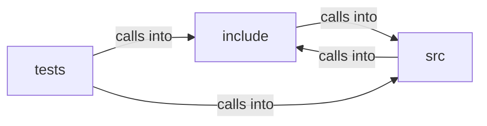

# src: http_cache

src: http_cache groups 16 files (c, h) around FREEDOM_LOCAL_STORE_H, LS_KEY_LEN, LS_SALT_LEN, LS_NONCE_LEN, LS_TAG_LEN. cf_set_store: Cache-aware GET.

## include (7.1)

include groups 5 files (h) around FREEDOM_LOCAL_STORE_H, LS_KEY_LEN, LS_SALT_LEN, LS_NONCE_LEN, LS_TAG_LEN. cf_set_store: Cache-aware GET.

## src (7.2)

src groups 6 files (c) around _POSIX_C_SOURCE, trace, cf_set_store, cf_store, cacheable_request. trace: fetcher, and so the same policy, as an uncached request.  #define...

## tests (7.3)

tests groups 5 files (c) around _GNU_SOURCE, NOW, fake_fetch, setup, teardown.

**Files**:

- include/cached_fetch.h
- include/disk_store.h
- include/http_cache.h
- include/local_store.h
- include/pq_seal.h
- src/cached_fetch.c
- src/disk_store.c
- src/http_cache.c
- src/local_store.c
- src/pq_seal.c
- src/profile.c
- tests/test_cached_fetch.c
- tests/test_disk_store.c
- tests/test_http_cache.c
- tests/test_local_store.c
- tests/test_pq_seal.c
