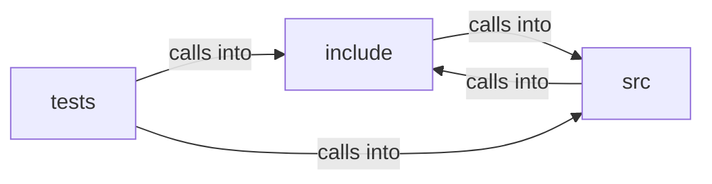

# src: http_cache

src: http_cache groups 13 files (c, h) around FREEDOM_LOCAL_STORE_H, LS_KEY_LEN, LS_SALT_LEN, LS_NONCE_LEN, LS_TAG_LEN. ds_free: Reads and decrypts path.

## include (8.1)

include groups 4 files (h) around FREEDOM_LOCAL_STORE_H, LS_KEY_LEN, LS_SALT_LEN, LS_NONCE_LEN, LS_TAG_LEN. ds_free: Reads and decrypts path.

## src (8.2)

src groups 5 files (c) around _POSIX_C_SOURCE, fsync_dir, map_ls, ds_write, ds_read. fsync_dir: Best-effort fsync of the directory holding path, for crash durability of...

## tests (8.3)

tests groups 4 files (c) around _POSIX_C_SOURCE, dir, fixture, setup, teardown.

**Files**:

- include/disk_store.h
- include/http_cache.h
- include/local_store.h
- include/pq_seal.h
- src/disk_store.c
- src/http_cache.c
- src/local_store.c
- src/pq_seal.c
- src/profile.c
- tests/test_disk_store.c
- tests/test_http_cache.c
- tests/test_local_store.c
- tests/test_pq_seal.c
