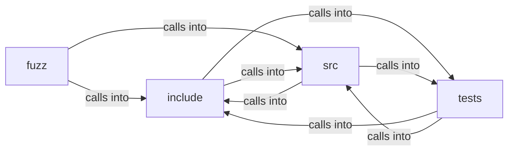

# src: tab

src: tab groups 72 files (c, h) around FREEDOM_HTML_PARSE_H, hp_status, max_bytes, hp_config, hp_document. Fuzzer for anchor (spec/anchor.md) and url_split_location: a hostile document x a

## fuzz (1.1)

fuzz groups 8 files (c) around check_decode, check_location, LLVMFuzzerTestOneInput, fz_out, fz_emit. Fuzzer for anchor (spec/anchor.md) and url_split_location: a hostile document x a

## include (1.2)

include groups 19 files (h) around FREEDOM_HTML_PARSE_H, hp_status, max_bytes, hp_config, hp_document. anc_collect: Writes target and its element subtree in preorder (*nsub handles), then...

## src (1.3)

src groups 28 files (c, h) around FREEDOM_JS_NATIVE_INTERNAL_H, js_context, js_host_slot, FREEDOM_JS_CUSTOM_ELEMENTS_H, jdce_install. — the indicated part of a document and where it sits (spec/anchor.md).

## tests (1.4)

tests groups 17 files (c) around fixture, load, unload, tag, attr. — CMocka suite for the anchor module (spec/anchor.md).

**Files**:

- fuzz/fuzz_anchor.c
- fuzz/fuzz_css_import.c
- fuzz/fuzz_dom.c
- fuzz/fuzz_html_parse.c
- fuzz/fuzz_js_dom.c
- fuzz/fuzz_js_geom.c
- fuzz/fuzz_js_sandbox.c
- fuzz/fuzz_web_storage.c
- include/anchor.h
- include/css_import.h
- include/dom.h
- include/html_parse.h
- include/js_dom.h
- include/js_env.h
- include/js_geom.h
- include/js_intl.h
- include/js_location.h
- include/js_native.h
- include/js_sandbox.h
- include/js_trusted.h
- include/os_sandbox.h
- include/renderer.h
- include/sha2.h
- include/subreq_batch.h
- include/url.h
- include/util.h
- include/web_storage.h
- src/anchor.c
- src/css_import.c
- src/dom.c
- src/html_parse.c
- src/js_custom_elements.c
- src/js_custom_elements.h
- src/js_dom.c
- src/js_dom_ext.c
- src/js_dom_ext.h
- src/js_dom_internal.h
- src/js_embed.c
- src/js_env.c
- src/js_events.c
- src/js_fetch.c
- src/js_geom.c
- src/js_intl.c
- src/js_location.c
- src/js_location_internal.h
- src/js_native_internal.h
- src/js_sandbox.c
- src/js_trusted.c
- src/os_sandbox.c
- src/renderer.c
- src/sha2.c
- src/subreq_batch.c
- src/tab.c
- src/url.c
- src/web_storage.c
- tests/test_anchor.c
- tests/test_css_import.c
- tests/test_dom.c
- tests/test_html_parse.c
- tests/test_js_dom.c
- tests/test_js_env.c
- tests/test_js_geom.c
- tests/test_js_intl.c
- tests/test_js_native.c
- tests/test_js_sandbox.c
- tests/test_os_sandbox.c
- tests/test_renderer.c
- tests/test_sha2.c
- tests/test_subreq_batch.c
- tests/test_tab.c
- tests/test_url.c
- tests/test_web_storage.c
