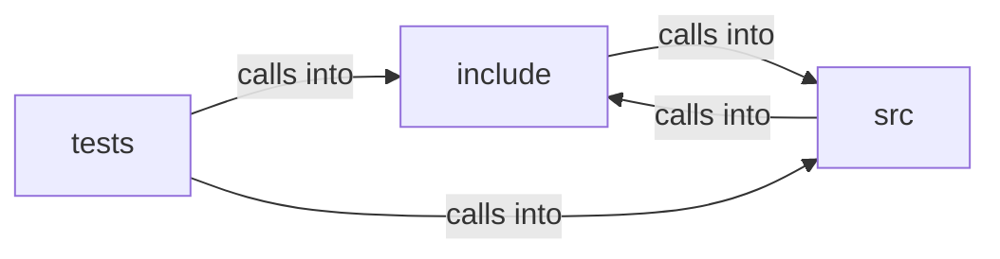

# src: tab

src: tab groups 45 files (c, h) around FREEDOM_HTML_PARSE_H, hp_status, max_bytes, hp_config, hp_document. ccm_get: Writes the computed value of the kebab-case property `prop` into out (cap...

## include (3.1)

include groups 13 files (h) around FREEDOM_HTML_PARSE_H, hp_status, max_bytes, hp_config, hp_document. ccm_get: Writes the computed value of the kebab-case property `prop` into out (cap...

## src (3.2)

src groups 21 files (c, h) around FREEDOM_JS_CUSTOM_ELEMENTS_H, jdce_install, FREEDOM_JS_DOM_INTERNAL_H, jd_opaque_get, jd_idx. ua_display: The HTML Rendering UA sheet's `display` for a tag when the cascade...

## tests (3.3)

tests groups 11 files (c) around get, blank, test_initial_values, test_declared_values, test_ua_display_by_tag. setup_doc: #include "dom.h" #include "html_parse.h" static const char HTML[] =...

**Files**:

- include/css_computed.h
- include/dom.h
- include/freebug.h
- include/html_parse.h
- include/js_dom.h
- include/js_env.h
- include/js_geom.h
- include/js_location.h
- include/js_sandbox.h
- include/js_trusted.h
- include/tab.h
- include/url.h
- include/web_storage.h
- src/css_computed.c
- src/freebug.c
- src/html_parse.c
- src/js_custom_elements.c
- src/js_custom_elements.h
- src/js_dom.c
- src/js_dom_ext.c
- src/js_dom_ext.h
- src/js_dom_internal.h
- src/js_embed.c
- src/js_env.c
- src/js_events.c
- src/js_fetch.c
- src/js_geom.c
- src/js_location.c
- src/js_location_internal.h
- src/js_sandbox.c
- src/js_trusted.c
- src/tab.c
- src/url.c
- src/web_storage.c
- tests/test_css_computed.c
- tests/test_dom.c
- tests/test_freebug.c
- tests/test_html_parse.c
- tests/test_js_dom.c
- tests/test_js_env.c
- tests/test_js_geom.c
- tests/test_js_sandbox.c
- tests/test_tab.c
- tests/test_url.c
- tests/test_web_storage.c
