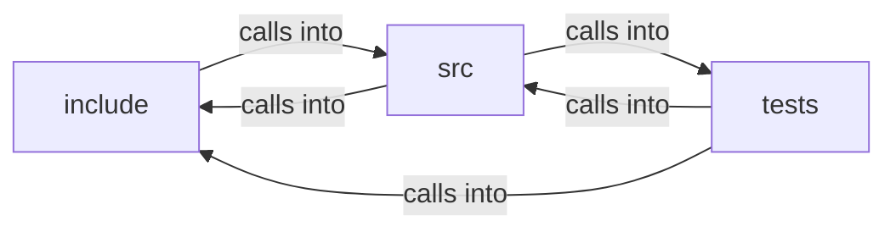

# src: tab

src: tab groups 54 files (c, h) around FREEDOM_HTML_PARSE_H, hp_status, max_bytes, hp_config, hp_document. ci_scan: Reads the leading @import rules of css[0,len) into out (at most cap).

## include (2.1)

include groups 15 files (h) around FREEDOM_HTML_PARSE_H, hp_status, max_bytes, hp_config, hp_document. ci_scan: Reads the leading @import rules of css[0,len) into out (at most cap).

## src (2.2)

src groups 25 files (c, h) around FREEDOM_JS_NATIVE_INTERNAL_H, js_context, js_host_slot, FREEDOM_JS_CUSTOM_ELEMENTS_H, jdce_install. css_import -- @import prelude reader (spec/css_import.md).

## tests (2.3)

tests groups 14 files (c) around scan, test_plain_url, test_url_forms, test_lobsters_media, assert_string_equal. test_css_import -- @import prelude reader (spec/css_import.md).

**Files**:

- include/css_import.h
- include/dom.h
- include/fb_cmdline.h
- include/freebug.h
- include/html_parse.h
- include/js_dom.h
- include/js_env.h
- include/js_geom.h
- include/js_intl.h
- include/js_location.h
- include/js_native.h
- include/js_sandbox.h
- include/js_trusted.h
- include/url.h
- include/web_storage.h
- src/css_import.c
- src/dom.c
- src/fb_cmdline.c
- src/freebug.c
- src/html_parse.c
- src/js_custom_elements.c
- src/js_custom_elements.h
- src/js_dom.c
- src/js_dom_ext.c
- src/js_dom_ext.h
- src/js_dom_internal.h
- src/js_embed.c
- src/js_env.c
- src/js_events.c
- src/js_fetch.c
- src/js_geom.c
- src/js_intl.c
- src/js_location.c
- src/js_location_internal.h
- src/js_native_internal.h
- src/js_sandbox.c
- src/js_trusted.c
- src/tab.c
- src/url.c
- src/web_storage.c
- tests/test_css_import.c
- tests/test_dom.c
- tests/test_fb_cmdline.c
- tests/test_freebug.c
- tests/test_html_parse.c
- tests/test_js_dom.c
- tests/test_js_env.c
- tests/test_js_geom.c
- tests/test_js_intl.c
- tests/test_js_native.c
- tests/test_js_sandbox.c
- tests/test_tab.c
- tests/test_url.c
- tests/test_web_storage.c
