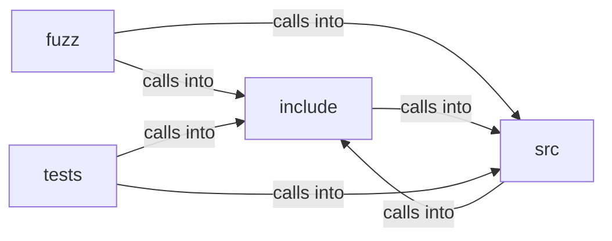

# src: text_shape

src: text_shape groups 55 files (c, h) around FREEDOM_HLS_H, hls_status, hls_segment, hls_variant, hls_playlist. libFuzzer harness for hls (spec/hls.md): hostile playlist text, hostile

## fuzz (4.1)

fuzz groups 7 files (c) around worker, LLVMFuzzerTestOneInput, FZ_CAP, LLVMFuzzerTestOneInput, glyph. libFuzzer harness for hls (spec/hls.md): hostile playlist text, hostile

## include (4.2)

include groups 16 files (h) around FREEDOM_HLS_H, hls_status, hls_segment, hls_variant, hls_playlist. du_is_data_url: 16 MiB of encoded text (~12 MiB decoded) -- generous for any real...

## src (4.3)

src groups 17 files (c) around lower, ci_starts_with, du_is_data_url, du_base64_payload, du_shape_ok. b64_val: 0-63 for a base64 alphabet character, -1 otherwise.

## tests (4.4)

tests groups 15 files (c) around test_is_data_url_true, test_is_data_url_false, test_payload_basic, test_payload_no_mediatype, test_payload_empty. test_unterminated_tag_stays_in_bounds: static void...

**Files**:

- fuzz/fuzz_data_url.c
- fuzz/fuzz_hls.c
- fuzz/fuzz_request_headers.c
- fuzz/fuzz_text_shape.c
- fuzz/fuzz_tls_impersonate.c
- fuzz/fuzz_webfont.c
- fuzz/fuzz_webfont_register.c
- include/data_url.h
- include/hls.h
- include/host_conf.h
- include/hostblock.h
- include/js_policy.h
- include/media_decoder.h
- include/net_realm.h
- include/perf_trace.h
- include/psl_data.h
- include/request_policy.h
- include/text_shape.h
- include/tls_impersonate.h
- include/webcaps.h
- include/webfont.h
- include/webfont_load.h
- include/wl_display.h
- src/data_url.c
- src/freedom.c
- src/hls.c
- src/host_conf.c
- src/hostblock.c
- src/js_policy.c
- src/media_decoder.c
- src/net_realm.c
- src/perf_trace.c
- src/render_policy.c
- src/request_policy.c
- src/text_shape.c
- src/tls_impersonate.c
- src/webcaps.c
- src/webfont.c
- src/webfont_load.c
- src/wl_display.c
- tests/test_data_url.c
- tests/test_hls.c
- tests/test_host_conf.c
- tests/test_hostblock.c
- tests/test_js_policy.c
- tests/test_media_decoder.c
- tests/test_net_realm.c
- tests/test_perf_trace.c
- tests/test_request_policy.c
- tests/test_text_shape.c
- tests/test_tls_impersonate.c
- tests/test_webcaps.c
- tests/test_webfont.c
- tests/test_webfont_load.c
- tests/test_wl_display.c
