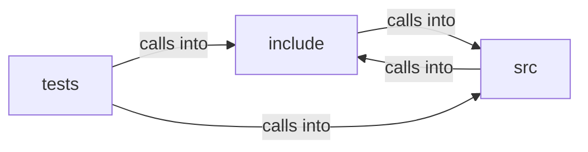

# src: text_shape

src: text_shape groups 39 files (c, h) around FREEDOM_HOSTBLOCK_H, hb_set, hb_list, hb_decision, hb_status. du_is_data_url: 16 MiB of encoded text (~12 MiB decoded) -- generous for any real...

## include (4.1)

include groups 13 files (h) around FREEDOM_HOSTBLOCK_H, hb_set, hb_list, hb_decision, hb_status. du_is_data_url: 16 MiB of encoded text (~12 MiB decoded) -- generous for any real...

## src (4.2)

src groups 14 files (c) around lower, ci_starts_with, du_is_data_url, du_base64_payload, b64_val. b64_val: 0-63 for a base64 alphabet character, -1 otherwise.

## tests (4.3)

tests groups 12 files (c) around test_is_data_url_true, test_is_data_url_false, test_payload_basic, test_payload_no_mediatype, test_payload_empty.

**Files**:

- include/data_url.h
- include/hls.h
- include/host_conf.h
- include/hostblock.h
- include/net_realm.h
- include/perf_trace.h
- include/psl_data.h
- include/request_policy.h
- include/text_shape.h
- include/tls_impersonate.h
- include/webfont.h
- include/webfont_load.h
- include/wl_display.h
- src/data_url.c
- src/freedom.c
- src/hls.c
- src/host_conf.c
- src/hostblock.c
- src/net_realm.c
- src/perf_trace.c
- src/render_policy.c
- src/request_policy.c
- src/text_shape.c
- src/tls_impersonate.c
- src/webfont.c
- src/webfont_load.c
- src/wl_display.c
- tests/test_data_url.c
- tests/test_hls.c
- tests/test_host_conf.c
- tests/test_hostblock.c
- tests/test_net_realm.c
- tests/test_perf_trace.c
- tests/test_request_policy.c
- tests/test_text_shape.c
- tests/test_tls_impersonate.c
- tests/test_webfont.c
- tests/test_webfont_load.c
- tests/test_wl_display.c
